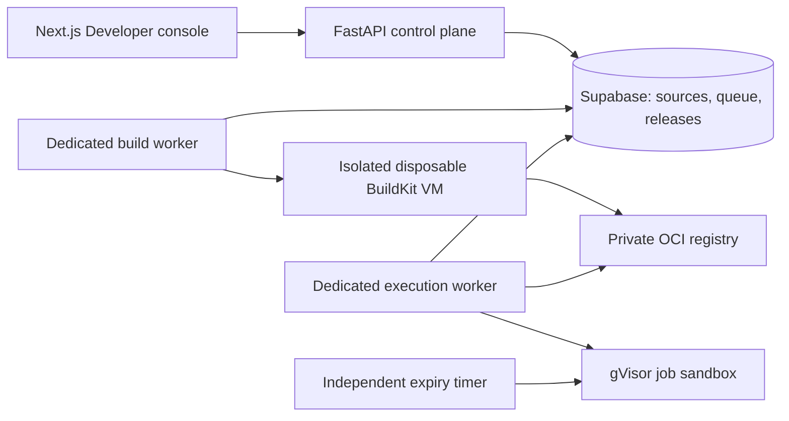

# Code Application hosting: first implementation

## Scope and current status

This is the first deployable slice of the proposed build/hosting platform: **private Python jobs with JSON inputs and outputs**. It adds real worker implementations and a durable database queue; the API and Next.js processes never import or run submitted code.

The machine used for implementation has no Docker, BuildKit or Go toolchain, and the app has not been hosted. **No cloud infrastructure was provisioned, no remote migration was applied, and no actual container build or sandbox execution has passed acceptance yet.** Browser tests simulate workers; database and API tests validate the control plane locally.

The migration is `supabase/migrations/20261026010000_code_app_jobs.sql`. Until an operator applies it, Code Application management returns a storage-configuration error. `CODE_APPS_ENABLED` defaults off: source editing is available after migration, while build/deploy/run actions remain disabled until hosting is configured.

## Delivered behavior

- New AI App → Developer → **Code Application** creates a private app without requiring an AI provider key. Existing insert policies and tier guards apply using the owner's session.
- A dedicated workspace supports editing multiple text files, importing a ZIP, configuring a validated execution manifest, saving immutable source versions, queuing builds, selecting an image for private deployment, running jobs and inspecting outputs/logs.
- Builds use a controlled Dockerfile, an operator-approved Python base image pinned by digest, hashed/pinned wheel dependencies, syntax compilation, an authenticated remote BuildKit service and an OCI registry. Arbitrary Dockerfiles, shell build commands and unpinned/VCS dependencies are not accepted.
- Runtime jobs pull an immutable per-app registry image and run as a non-root user under gVisor with outbound networking disabled, a read-only root filesystem, no host mounts or injected platform secrets, one CPU, memory/process limits and a bounded temporary filesystem.
- The job harness calls `module:function` with a JSON object; return values become JSON outputs. Normal `print()` messages become logs. Async functions are supported. There is no arbitrary shell entrypoint.
- Source, job payloads, worker leases and deployment pointers are inaccessible through browser database roles. Management is restricted to the signed-in app owner. Developer API keys and workspace editors are intentionally not authorized in this first release.
- A database transaction enforces two active jobs per owner across all apps, five builds and 100 runs per UTC day. Failed/cancelled jobs count. Source storage is limited to 20 new versions per rolling day per owner and 100 versions per app.
- Claims use row locks and fresh lease tokens. Expired jobs become interrupted and are never automatically replayed. Stale workers cannot renew ownership, update logs or complete a job. Status reads also recover expired jobs when there are no workers left.
- Deployment uses compare-and-swap against the previously active build. New jobs capture the selected image/source; existing jobs retain theirs. Deploying an earlier successful build performs rollback. The UI lists the latest 20 successful builds independently of recent run history.
- Running jobs can be cancelled. Active jobs block app deletion at both the API and database levels. Public publication/embeds are blocked for code apps, and prompt execution refuses code jobs before a model provider is called.

## Deployment topology



The builder VM, execution host and API host must be separate. Worker scripts are Python to reuse the current runtime and database client; this implementation does not introduce the proprietary Go AEX engine. A future Go control service can use the same source/build/deployment/job contracts.

## Operator setup

1. Review and apply pending migrations to the intended **staging** Supabase project, including the new code-job migration. Do not apply just this file if earlier migrations are missing. Back up the target before schema changes.
2. Provision separate dedicated Linux x86-64 build-control and execution hosts. Install the backend Python requirements in `/opt/aistrix/venv` and copy the backend source to `/opt/aistrix/aistrix-backend`. Customer programs must never run directly on either host's Python interpreter.
3. Provision a private OCI registry and approved Python image digest. Configure narrowly scoped registry credentials on the trusted hosts. The registry/repository prefix must match across build and execution workers. Images are always deployed by digest, never by mutable tag.
4. Provision BuildKit in a separate disposable VM. Run rootless, restrict access with mutual TLS, restrict build networking to approved dependency/registry endpoints, limit CPU/RAM/disk and enforce a VM lifetime limit of at most 10 minutes. BuildKit executes untrusted package installation code: an ordinary shared builder with an attestation flag is not an isolation boundary. The VM lifecycle, hard timeout and cleanup must be supplied by the infrastructure operator; the worker does not provision them.
5. On the execution host, install rootless Docker with cgroup v2/systemd resource enforcement and the gVisor `runsc` runtime. Use the dedicated user's local Docker socket. Do not use a rootful/remote daemon, host networking or a mounted Docker socket inside customer jobs. Verify resource enforcement and gVisor compatibility on the actual host before enabling traffic.
6. Copy `infra/code-workers/worker.env.example` outside the repository to `~/.config/aistrix/code-worker.env`, replace every placeholder and set file permissions to `0600`. Store real secrets using the host secret manager. Never put credentials in source archives or chat. The example is not an operational configuration until these prerequisites are fulfilled.
7. Install the systemd user units in `infra/code-workers` into `~/.config/systemd/user/`. On the execution host, enable `aistrix-code-reaper.timer` **before** starting the worker. The reaper runs independently of the worker, removing containers after their deadline if a worker dies. Configure the user manager to persist after logout. Worker preflight refuses execution without an active timer.

Commands on the prepared execution host:

```sh
systemctl --user daemon-reload
systemctl --user enable --now aistrix-code-reaper.timer
systemctl --user enable --now aistrix-code@run.service
```

On the separate build-control host:

```sh
systemctl --user daemon-reload
systemctl --user enable --now aistrix-code@build.service
```

For a foreground preflight, securely load that host's environment and run:

```sh
/opt/aistrix/venv/bin/python /opt/aistrix/aistrix-backend/code_worker.py --kind build --check
/opt/aistrix/venv/bin/python /opt/aistrix/aistrix-backend/code_worker.py --kind run --check
```

Run only the command appropriate to each host. Preflight checks installed prerequisites/configuration; it is not a penetration test or proof of all isolation properties.

8. Set `CODE_APPS_ENABLED=1` on the API after worker acceptance setup is ready. Restart the API and use the Code Application workspace with a dedicated staging account. A worker is considered available only while its heartbeat is less than 90 seconds old. Heartbeats/progress flush every 10 seconds; UI status refreshes every five seconds. Cancellation/expiry is asynchronous; the independent timer adds bounded cleanup delay.

## API contract

All endpoints require the owner's Supabase session bearer token and return `Cache-Control: private, no-store`.

| Method and route | Purpose |
|---|---|
| `POST /v1/code-apps` | Create private code app with `{name}` |
| `GET /v1/apps/{id}/code` | Source/starter, capabilities, limits, builds, recent tasks and active deployment |
| `PUT /v1/apps/{id}/code/source` | JSON `{files,manifest}` or ZIP with `Content-Type: application/zip` |
| `POST /v1/apps/{id}/code/builds` | Queue immutable `{source_id}`; returns 202 |
| `POST /v1/apps/{id}/code/deploy` | Select `{build_id,expected_build_id}`; null expected ID means first deployment |
| `POST /v1/apps/{id}/code/runs` | Queue a JSON input object against the active deployment; returns 202 |
| `GET /v1/apps/{id}/code/tasks/{task_id}` | Read one task and its bounded logs/results |
| `POST /v1/apps/{id}/code/tasks/{task_id}/cancel` | Cancel queued/running task and fence its worker |

Run requests may include `X-Code-Build-ID` to require the deployment version shown to the caller; a changed release is rejected. The UI sends this pin. Callers omitting it explicitly run whichever deployment is active when the job is queued.

Source bundles are at most 512 KiB, 32 files and 128 KiB per text file. ZIPs must be rooted at the project files, not a containing folder; links, hidden files, traversal paths and encrypted archives are rejected. Input and compact JSON output are bounded to 64 KiB, and logs to 64 KiB. The manifest accepts Python job mode, `module:function`, 1–120 seconds, 128/256/512/1024 MiB and networking `none`.

`examples/python-inventory-job` contains a real standard-library inventory reorder calculation, manifest and sample JSON. Zip the contents of that folder and import it. Expected result for its sample is one reorder of 35 units for `COFFEE-1`.

## Acceptance and outstanding work

The local checks cover source/path/dependency restrictions, input/output limits, tenant/owner access, RPC privileges, quotas, lease fencing, cancellation, private publication guards, deployment compare-and-swap/rollback, and browser creation/save/build/deploy/run journeys. Container execution is simulated in browser tests.

Verification completed on October 26, 2026:

- Full frontend regression run: 44 files, 387 checks passed. A subsequently added authenticated-creation database case also passed; the final code-job database file has nine passing cases.
- Backend: 25 new isolated Python/API/worker cases plus three existing deployment/execution/access suites passed. The deployment suite passed again after the final workflow-schema compatibility guard.
- Browser: nine desktop creation/Build/code-app journeys and all 38 native Next.js desktop/mobile route checks passed. Nine desktop-only editing cases were skipped in the mobile project.
- The final staging-configured Next.js production build passed locally. The staging acceptance runner correctly reported NOT RUN without hosted settings. No real container execution was attempted.

`aistrix-backend/scripts/verify_code_hosting.py` is an explicit staging acceptance runner. Configure `CODE_ACCEPTANCE_API` (HTTPS API origin), `CODE_ACCEPTANCE_TOKEN` (dedicated owner's session token) and `CODE_ACCEPTANCE_ENVIRONMENT=staging` locally. Then run with the dedicated code app ID:

```sh
python scripts/verify_code_hosting.py --app-id YOUR_TEST_APP_UUID --execute
```

It consumes one real build and one run, verifies output and restores a previous active build if one existed. Without settings/`--execute`, it reports **NOT RUN**. It does not provision infrastructure. Do not use a real customer's app for acceptance.

Before exposing untrusted workloads, also verify on the actual worker hosts: blocked network/host access; CPU, memory, process and disk exhaustion; timeout/output flooding; worker termination and independent cleanup; registry access boundaries; source/log/image retention; build VM teardown; and recovery after database/network outages. Elapsed milliseconds and declared limits are recorded; actual CPU/RAM/network billing and dollar spending reservations are not implemented yet.

Subsequent slices remain necessary for the full proposed platform: GitHub repository authorization/import and auto-deploys; managed object storage/artifact downloads; dedicated scoped worker identities instead of service-role credentials on trusted hosts; Go AEX scheduling; Kubernetes placement/autoscaling; Node/TypeScript; long-lived API/web servers, health-gated traffic switching and domains; approved secret/egress capabilities; code steps integrated with durable workflows; and Temporal-backed long-running orchestration. The existing workflow engine remains in place in this release. Mobile compilation/signing/store distribution is outside this Python-job slice.
